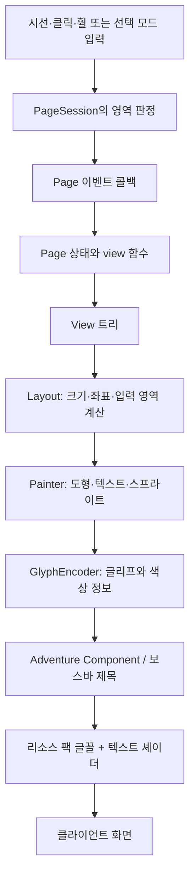

# VoidRP UI 플러그인 분석 보고서

분석일: 2026-11-07  
분석 기준: 현재 저장소의 README, Gradle 설정, 플러그인 등록 정보, Kotlin 소스 및 내부 문서. 서버·클라이언트를 실행하지 않은 정적 분석이며, 버전 호환성과 성능 수치는 실측 검증 결과가 아니다.

## 1. 어떤 플러그인인가

**VoidRP UI는 별도 클라이언트 모드 없이 마인크래프트에 그래픽 인터페이스를 표시하는 Paper 서버용 UI 프레임워크다.** 플레이어가 서버 리소스 팩을 적용하면 패널, 버튼, 이미지, 툴팁, 커서 등을 볼 수 있다. 개발자는 Kotlin 코드로 페이지를 구성하고 다른 서버 플러그인에서 API로 열 수 있다.

핵심은 보스바 제목에 들어가는 텍스트를 화면의 도형과 글자로 해석하는 기술이다. 리소스 팩에 특수 글꼴과 텍스트 셰이더를 넣고, 서버가 보내는 글리프와 색상에 위치·색상 등의 정보를 실어 UI를 그린다. 웹 브라우저나 HTML을 내장한 구조는 아니다.

내장 홈 화면, 컴포넌트 데모, 상점 화면은 프레임워크의 사용 예시다. 실제 서버 경제·아이템 지급·데이터베이스를 완성해 제공하는 상점 플러그인으로 보면 안 된다. 특히 `ShopPage`의 구매 처리는 페이지 내부 잔액 변경과 채팅 안내이며, 실제 아이템 지급이나 경제 플러그인 연동은 없다.

| 항목 | 저장소에서 확인한 내용 |
|---|---|
| 플러그인 이름 | `VoidRpUI` |
| 프로젝트 버전 | `0.4.0` |
| 진입점 | `ru.voidrp.ui.VoidRpUiPlugin` |
| 서버 플랫폼 | Paper. README는 Spigot 단독 실행을 지원하지 않는다고 명시 |
| 언어·빌드 | Kotlin 2.4.20, Gradle Kotlin DSL, Shadow, Maven Publish |
| 컴파일 API | Paper `26.2.build.124-stable` |
| Java 설정 | 컴파일 도구 체인 25, 생성 바이트코드 JVM 21 |
| 플러그인 API 버전 | `plugin.yml`의 `api-version: '1.21'` |
| 클라이언트 지원 범위 | README 기준 1.21.6~26.1.2용 레거시 팩과 26.2 이상용 팩 |
| 선택 의존성 | PacketEvents 2.13.0 API를 컴파일 시 참조, 서버에 없으면 대체 경로 사용 |
| 라이선스 | MIT. 포함된 Inter 글꼴은 SIL OFL |

Java 21 바이트코드를 만든다는 사실만으로 모든 Paper 버전과의 호환성이 보장되는 것은 아니다. 서버 실행에 필요한 Java 버전은 해당 서버 버전의 요구 사항을 따르며, 위 클라이언트 지원 범위도 서버 버전 범위와 구분해야 한다.

근거: [README](README.md), [빌드 설정](build.gradle.kts), [플러그인 등록 정보](src/main/resources/plugin.yml).

## 2. 프로젝트 구조

주요 소스의 공통 경로는 `src/main/kotlin/ru/voidrp/ui/`다.

```text
프로젝트/
├─ build.gradle.kts           빌드·의존성·테스트·프리뷰 태스크
├─ src/main/kotlin/ru/voidrp/ui/
│  ├─ VoidRpUiPlugin.kt       시작·종료, 팩 생성·전송, 설정 초기화
│  ├─ Messages.kt, Sounds.kt  메시지와 UI 효과음
│  ├─ api/                   외부 플러그인용 VoidRpUi 서비스
│  ├─ command/               /vui 및 개발·디버그 명령
│  ├─ page/                  페이지, 플레이어 세션, 탐색, 입력창, 내장 화면
│  ├─ layout/                View 트리, 측정·배치, 반응형 화면 크기
│  ├─ widget/                버튼·탭·슬라이더 등 조합형 컴포넌트
│  ├─ style/                 테마·스타일·색상 팔레트
│  ├─ render/                도형 변환·글리프 인코딩·보스바·월드 표시
│  ├─ pack/                  글꼴·아이콘·셰이더·리소스 팩 생성 및 HTTP 배포
│  ├─ input/                 시선 커서, 보간, 패킷 입력, 선택 모드 연동
│  └─ preview/               서버 접속 없이 PNG 프리뷰 생성
├─ src/main/resources/       plugin.yml, 설정·메시지·테마·글꼴·아이콘 리소스
├─ src/test/kotlin/          인코딩·배치·팩·커서 테스트와 벤치마크
├─ example/                  API를 사용하는 독립 예제 플러그인
└─ docs/                     레이아웃·페이지·컴포넌트·테마·내부 원리 문서
```

### 각 계층의 역할

| 계층 | 핵심 파일 | 역할 |
|---|---|---|
| 생명주기 | `VoidRpUiPlugin.kt` | 설정과 자원 준비, 현대/레거시 팩 생성, HTTP 서버 시작, 이벤트·명령·서비스 등록, 종료 시 정리 |
| 공개 API | `api/VoidRpUi.kt` | 페이지 열기·닫기·현재 페이지 조회, 팩 재전송, 화면 비율·커서 설정 |
| 페이지 실행 | `page/PageManager.kt`, `PageSession.kt` | 플레이어별 세션, 페이지 스택, 이벤트 전달, 레이아웃 및 렌더링 갱신 |
| 화면 선언 | `page/Page.kt`, `layout/View.kt` | 상태에 따른 `View` 트리와 클릭·드래그·스크롤 등 콜백 정의 |
| 레이아웃 | `layout/Layout.kt` | 크기 측정, 좌표 계산, 줄바꿈, 스크롤 영역과 입력 판정 영역 생성 |
| 그리기 | `render/Painter.kt`, `Element.kt` | 패널 스타일을 그리기 요소로 변환하고 Adventure 텍스트 컴포넌트로 인코딩 |
| 전송 | `render/BossBarRenderer.kt`, `PageParts.kt` | 화면을 보스바별로 분할하고 달라진 부분을 갱신 |
| 리소스 | `pack/PackBuilder.kt`, `Shaders.kt`, `PackServer.kt` | 클라이언트가 해석할 글꼴·셰이더·이미지 구성과 ZIP 배포 |
| 입력 | `input/Pointer.kt`, `PacketAim.kt`, `ClientPointer.kt` | 시선 또는 선택 모드의 마우스 입력을 화면 좌표로 연결 |

## 3. 작동 원리

### 3.1 시작 및 리소스 팩 전달

1. `VoidRpUiPlugin.onEnable()`에서 설정, 메시지, 테마, 화면·커서 설정을 준비한다.
2. `PackBuilder`가 도형 글리프, 텍스트, 아이콘, 사용자 이미지, 셰이더를 포함한 팩을 만든다. 기본적으로 현대 팩과 레거시 팩 두 개를 생성한다.
3. 외부 `pack.url`이 없으면 내장 HTTP 서버가 기본 포트 `8123`에서 ZIP을 제공한다.
4. 이벤트 리스너와 `/vui` 명령을 등록하고, `PageManager`를 Bukkit 서비스 `VoidRpUi`로 공개한다.
5. 플레이어 접속 시 설정에 따라 리소스 팩을 전송한다. PacketEvents가 있으면 클라이언트 버전으로 팩을 선택하고, 없으면 현대 팩 적용 실패 시 레거시 팩으로 재시도하는 경로가 있다.
6. 기본 설정에서는 팩 적용이 확인되어야 페이지를 연다. 첫 화면에서는 화면 비율 설정을 먼저 요청한다.

팩은 화면의 모든 상태를 이미지로 미리 저장한 것이 아니다. 도형과 글꼴 등 그리기 재료가 팩에 있고, 현재 페이지 내용과 좌표는 서버가 실행 중 전송한다. 버튼이나 텍스트의 상태 변경마다 팩을 다시 만들 필요는 없다. 새 이미지·스킨 등 팩에 들어가는 자산을 추가할 때는 재생성과 재배포가 필요하다.

### 3.2 페이지에서 화면까지



`Page.view()`는 현재 상태를 바탕으로 `Panel`, `Text`, `Grid`, `Scroll` 등의 트리를 반환한다. 상태 변경 후 `refresh()`를 부르면 화면을 다시 계산한다. 작성자는 요소를 하나씩 직접 갱신할 필요가 없다. 전송 단계에서는 이전 결과와 동일한 화면 조각을 다시 보내지 않는다.

`Layout`은 그리기 요소와 함께 `id`가 있는 영역의 위치도 계산한다. 세션은 이 영역과 포인터 좌표를 비교해 어떤 버튼을 눌렀는지 판정한다. 화면 표시와 클릭 판정이 같은 배치 결과를 사용한다.

### 3.3 텍스트로 그래픽을 표현하는 방법

| 표현할 정보 | 전달 방법 |
|---|---|
| 가로 위치 | 양수·음수 폭을 가진 보이지 않는 공백 글리프로 글쓰기 위치 이동 |
| 세로 위치 | 글리프 색상에 담긴 10비트 값 |
| 채우기 색 | 색상에 담긴 RGB 3-4-3, 총 10비트 값 |
| 특수 UI 식별 | 색상의 상위 마커 비트 |
| 도형·크기 | 사전에 생성한 사각형·모서리 등의 글리프 선택 |
| 투명도 | 16단계로 생성한 글꼴 중 하나 선택 |

셰이더는 UI 마커가 있는 글리프를 인식해 화면의 지정 위치로 이동시킨다. 텍스트 한 줄의 최종 폭은 공백 글리프로 0으로 되돌려 보스바 중앙 정렬에 따른 위치 이동을 막는다. 따라서 서버가 계산한 글리프 폭과 클라이언트의 실제 폭이 정확히 일치해야 한다.

화면은 최대 네 보스바로 구성한다. 두 개는 본문, 하나는 하이라이트·툴팁, 하나는 커서를 담당한다. 스크롤 영역처럼 바뀌는 부분을 별도 조각으로 나누므로 커서 이동마다 본문 전체를 재전송하지 않는다. 보스바 자체의 막대는 리소스 팩의 투명 텍스처로 숨긴다.

근거: [내부 원리](docs/internals.md), [인코더](src/main/kotlin/ru/voidrp/ui/render/Element.kt), [보스바 렌더러](src/main/kotlin/ru/voidrp/ui/render/BossBarRenderer.kt).

### 3.4 입력과 커서

바닐라 클라이언트는 플레이 중 일반 마우스 좌표를 서버에 보내지 않는다. 기본 조작은 플레이어의 yaw·pitch, 즉 바라보는 방향의 변화를 커서 이동으로 바꾸는 방식이다. 입력 사이에는 보간·예측을 적용하며, 지원되는 현대 클라이언트에서는 셰이더가 커서 움직임을 이어 그리는 경로도 있다.

- 왼쪽 클릭은 팔 휘두르기, 오른쪽 클릭은 상호작용 이벤트에서 가져온다.
- 휠과 숫자키는 핫바 슬롯 변경으로 전달된다. `usesKeys` 페이지에서는 슬롯 선택을 `onKey()`로 처리하며, 휠과 숫자키를 완전히 독립된 입력처럼 구분하지 못한다.
- 슬라이더와 스크롤바는 드래그 콜백을 사용한다.
- 웅크리기는 이전 페이지로 돌아가거나 마지막 페이지를 닫는다.
- 문자열 입력은 Minecraft/Paper의 네이티브 Dialog 텍스트 필드를 사용한다.
- UI가 열린 동안 블록 파괴·블록 손상·플레이어의 직접 공격 등의 게임 행동을 취소하는 처리가 있다.

PacketEvents는 선택 사항이다. 설치되면 회전 패킷을 더 일찍 읽고, 클라이언트 버전을 파악하며, 다른 플러그인의 보스바를 UI 표시 중 숨겼다가 복원한다.

선택 클라이언트 모드 `voidrp-client-info` 1.2.0 이상과의 연동도 구현되어 있다. 모드가 제공하는 실제 마우스·버튼·휠·키·창 크기를 사용하며, 시스템 커서와 Escape 뒤로가기를 지원한다. README가 명시하는 해당 모드 환경은 NeoForge 26.2이며, 기본 사용에 필수는 아니다.

## 4. 제공 기능

| 분류 | 기능 |
|---|---|
| 레이아웃 | 행·열, 간격, 정렬, 자동/고정/채움/비율 크기, 최소·최대 크기, 행 줄바꿈, 그리드, 스크롤, 오버레이 |
| 스타일 | 배경, 투명도, 둥근 모서리, 테두리, 패딩, 그림자, 글로우, 상단 강조, 그라디언트 |
| 텍스트 | Inter, 여러 크기·굵기, 줄바꿈·말줄임, 정렬·자간, 한 줄 안의 색상·크기 혼합, 사용자 글꼴 |
| 이미지 | 바닐라 아이템·블록 아이콘, UI 아이콘, 서버 PNG 이미지, 미리 등록한 플레이어 얼굴 |
| 기본 위젯 | 버튼, 아이콘 버튼, 체크박스, 토글, 수량 조절기, 드롭다운, 슬라이더, 진행률, 칩 |
| 복합 위젯 | 탭, 카드, 통계 타일, 툴팁, 알림, 빈 상태, 스켈레톤, 구분선, 다이얼로그 |
| 페이지 | 플레이어별 세션, 페이지 스택, 열기·닫기 콜백, 상태 변경에 따른 재렌더링 |
| 반응형 | 높이 1024 기준 캔버스, 화면 비율에 따른 폭, 브레이크포인트·열 수 계산, 중앙 안전 영역 |
| 테마 | midnight, daylight, ember, grove 및 `theme.yml` 사용자 지정 |
| 개인 설정 | 화면 비율과 커서 설정 저장, 감도·움직임 방식·시계 보정 설정 |
| 효과 | UI 효과음, 셰이더 시간값으로 움직이는 배경 파티클 |
| 개발 도구 | PNG 프리뷰, 배치 텍스트 덤프, 커서 추적·디버깅, 벤치마크, 팩 용량 측정 |
| 실험 기능 | 월드 내 TextDisplay에 페이지 표시, 시선 교차점으로 선택 |

아이템 아이콘 수 788개는 README의 설명이다. 레거시 팩에서는 구버전에 없는 텍스처 193개를 동일 폭의 공백으로 대체하므로 화면 배치가 유지되어도 일부 아이콘은 보이지 않는다.

## 5. 설정·명령·운영 데이터

기본 데이터 경로는 `plugins/VoidRpUI/`다.

| 파일·폴더 | 용도 |
|---|---|
| `config.yml` | 팩 URL·포트, 입력 감도·보간·예측, 화면, 효과음, 선택 연동 설정 |
| `theme.yml` | 색상·글자 크기·모서리 등 디자인 토큰 |
| `messages.yml` | 플레이어 메시지, MiniMessage 지원. 최초 생성 언어는 en/ru |
| `screens.yml` | 플레이어별 화면 비율 |
| `cursor.yml` | 플레이어별 커서 설정 |
| `images/` | `Picture`가 참조할 PNG |
| `heads/` | 얼굴을 생성할 스킨 PNG |
| `pack/` | 생성 팩에 병합할 사용자 리소스. 플러그인 생성 경로와 충돌하면 제외 |
| `voidrp-ui.zip`, `voidrp-ui-legacy.zip` | 생성되는 현대·레거시 팩 |
| `preview/` | 게임 내 디버그 명령이 출력하는 프리뷰 |

`pack.required` 기본값은 false이므로 팩 거부가 곧 접속 차단을 의미하지 않는다. 반면 `pack.require-accepted` 기본값은 true이므로 팩을 적용하지 않으면 UI 열기를 거부한다. 내장 HTTP 서버를 외부에서 사용할 경우 해당 포트에 접근할 수 있어야 하며, 프록시·CDN 환경에서는 팩 URL과 `pack.legacy-url`, 필요 시 `pack.publish-dir`을 설정한다.

| 명령 | 기능 |
|---|---|
| `/vui open` | 홈 페이지 |
| `/vui demo` | 컴포넌트 데모 |
| `/vui close` | 페이지 닫기 |
| `/vui pack` | 리소스 팩 다시 받기 |
| `/vui screen [비율]` | 화면 비율 설정 |
| `/vui cursor` | 개인 커서 설정 |
| `/vui help` | 도움말 |
| `/vui debug ...` | 프리뷰·레이아웃·인코딩·입력 진단. `voidrp.ui.debug` 필요 |

`voidrp.ui.world`는 실험적 월드 표시 선택 권한이며 기본값은 op다. `voidrp.ui.use`는 등록 정보에 기본 true로 선언되어 있으나, 확인한 `UiCommand`의 일반 명령 분기에는 이 권한을 명시적으로 검사하는 코드가 없다. 권한 노드를 선언했다는 것과 실제 접근을 차단한다는 것은 구분해야 한다.

## 6. 다른 플러그인에서 확장하는 방식

```kotlin
val ui = VoidRpUi.get() ?: return
ui.open(player, MyShopPage())
```

`MyShopPage`는 `Page`를 상속해 `view()`를 구현하고, 필요한 이벤트 콜백에서 데이터를 변경한 뒤 `refresh()`를 호출한다. 버튼에 부여한 `id`가 `onClick(id, button)`으로 전달된다. 데이터 조회·권한 확인·구매 검증·아이템 지급·영속 저장 등 서버 업무 로직은 호출하는 플러그인에서 구현해야 한다.

공개 진입점은 Bukkit 서비스이므로 구현 클래스에 직접 캐스팅할 필요가 없다. `example/`에 독립적으로 빌드할 수 있는 연동 예제가 있다. README의 의존성 예시는 `compileOnly("com.github.VOIDRP-MINECRAFT:voidrp-ui:v0.4.0")`다.

Kotlin 표준 라이브러리는 서버가 `plugin.yml`의 `libraries`로 가져온다. 연동 Kotlin 플러그인은 `depend: [VoidRpUI]`를 선언하고 Kotlin을 자체 JAR에 중복 포함하거나 재배치하지 않는 구성이 안내되어 있다. Java에서 선택적으로 사용하는 경우에는 `softdepend`와 서비스 존재 확인을 사용할 수 있다.

## 7. 제약 및 확인할 사항

1. **리소스 팩 적용이 사실상 필수다.** 도형·글꼴·셰이더가 없으면 의도한 화면을 표시할 수 없다.
2. **바닐라 조작은 시선 기반이다.** 실제 마우스 커서와 같은 조작감을 보장하지 않으며, 시선 입력 주기와 네트워크 지연에 영향을 받는다. 화면을 연 상태에서도 플레이어의 머리는 실제로 회전한다.
3. **바닐라에서는 창 크기를 자동으로 알 수 없다.** 사용자 설정값을 사용한다. 선택 모드 연동 시 실제 창 크기를 받을 수 있다.
4. **색상·투명도 표현에 제한이 있다.** RGB 10비트와 투명도 16단계라 특히 어두운 색과 그라디언트에 오차가 생긴다. `Palette.express(..., over=...)`는 배경과 합성한 결과를 고려해 이를 줄인다.
5. **새 이미지와 얼굴은 팩에 먼저 들어 있어야 한다.** 접속한 플레이어의 스킨을 수집해도 현재 배포된 팩에 얼굴이 즉시 추가되는 것은 아니다. 스킨 주소는 플레이어 프로필에서 읽지만, 실제 PNG를 저장할 때는 해당 URL로 다운로드하는 코드가 있다.
6. **보스바와 텍스트 셰이더를 공유한다.** PacketEvents가 없으면 다른 플러그인의 보스바로 위치가 밀릴 수 있다. 텍스트 셰이더 자체를 교체하는 클라이언트 수정과는 충돌할 수 있다.
7. **월드 표시 모드는 실험 기능이다.** 손·핫바 겹침, 주변 블록 관통, 월드 셰이더 팩과의 호환 문제를 README가 명시한다.
8. **성능 수치는 참고 자료다.** README에는 페이지 배치·인코딩 약 3ms, 초기 전송 약 90KB, 커서 프레임 약 130바이트 등의 수치가 있다. 현재 설정의 기본 프레임 전송률은 40이고 현대 팩의 클라이언트 보간 경로도 있어, README의 초당 85회 예시를 현재 모든 환경의 고정 동작으로 해석하면 안 된다.

## 8. 테스트 및 개발 도구

저장소에는 글리프 폭·펜 위치, 색상 팔레트, 줄바꿈, 스크롤, 반응형 크기, 위젯 배치, 툴팁, 이미지, 커서 움직임, 레거시 아이콘 등을 검사하는 테스트가 있다. 실제 생성한 팩의 PNG에서 글리프 폭을 측정하고 클라이언트의 글쓰기 규칙을 모사하는 테스트가 핵심이다.

| Windows 명령 | 목적 |
|---|---|
| `.\gradlew.bat test` | 자동 테스트 |
| `.\gradlew.bat preview` | `build/preview`에 데모 화면 생성 |
| `.\gradlew.bat bench` | 페이지 생성 비용 측정 |
| `.\gradlew.bat packWeight` | 팩 용량 측정 |
| `.\gradlew.bat build` | 빌드 및 Shadow JAR 생성 |

`VOIDRP_CLIENT_JAR`를 지정하면 클라이언트 JAR의 실제 아이템 텍스처로 관련 테스트와 프리뷰를 보완할 수 있다. 프리뷰에는 `VOIDRP_HEADS`, `VOIDRP_IMAGES`도 사용할 수 있다. 이번 작업은 문서 작성 범위로 진행했으며 빌드·테스트·게임 접속은 실행하지 않았다.

## 9. 분석 근거

- [README](README.md): 목적, 설치, 지원 범위, 기능, 알려진 제약과 성능 설명
- [Gradle 설정](build.gradle.kts), [plugin.yml](src/main/resources/plugin.yml), [config.yml](src/main/resources/config.yml): 실제 버전·의존성·권한·기본 설정
- [VoidRpUiPlugin](src/main/kotlin/ru/voidrp/ui/VoidRpUiPlugin.kt): 초기화, 리소스 팩 처리, 서비스 등록, 스킨 다운로드
- [VoidRpUi API](src/main/kotlin/ru/voidrp/ui/api/VoidRpUi.kt), [Page](src/main/kotlin/ru/voidrp/ui/page/Page.kt), [PageManager](src/main/kotlin/ru/voidrp/ui/page/PageManager.kt): 외부 연동, 페이지 모델, 입력 라우팅
- [ShopPage](src/main/kotlin/ru/voidrp/ui/page/ShopPage.kt): 내장 상점 데모의 실제 처리 범위
- [Widgets](src/main/kotlin/ru/voidrp/ui/widget/Widgets.kt), [View](src/main/kotlin/ru/voidrp/ui/layout/View.kt), [Layout](src/main/kotlin/ru/voidrp/ui/layout/Layout.kt): 제공 UI 구성 요소와 배치
- [내부 원리 문서](docs/internals.md), [반응형 문서](docs/responsive.md), [페이지 문서](docs/page.md), [예제](example/README.md): 설계 설명과 확장 방법
